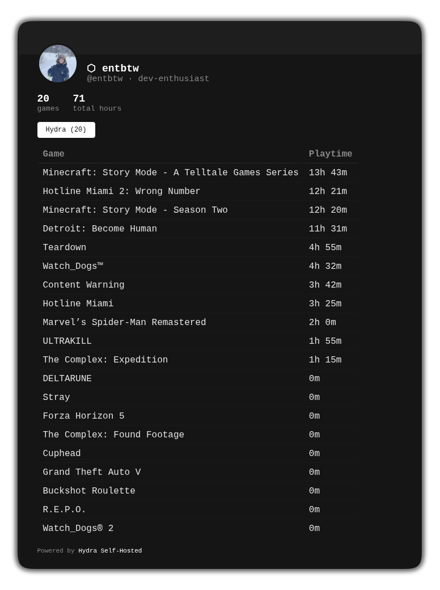

# hydra-selfhosted

Self-hosted backend for the [entitybtw/hydra](https://github.com/entitybtw/hydra) fork of Hydra Launcher — cloud saves, accounts, profiles and game data on your own server, without a Hydra Cloud subscription.



## Features

- **Accounts** — register / login, sessions, optional passkeys (WebAuthn)
- **Public profiles** — shareable page at `/u/username` with playtime, library and recent activity; avatar, banner, bio, accent color and custom CSS
- **Steam integration** — connect Steam to show hours and library (synced every 30 min)
- **Cloud saves** — unlimited slots on your own server, 50 MB per upload by default
- **Library management** — pin / favorite games, playtime tracking, per-tab section order and visibility
- **Web dashboard** — full UI at `/` (profile editing, library, password change, admin panel)
- **API docs** — built-in reference at `/docs`
- **Launcher compatibility** — Big Picture, friendships stub and `/download-sources` proxy all work out of the box

## Quick start

```bash
git clone https://github.com/entitybtw/hydra-selfhosted.git
cd hydra-selfhosted
cp .env.example .env
# edit .env — set API_TOKEN to a random secret string
docker compose up -d
```

The prebuilt image [`entbtw/hydra-selfhosted`](https://hub.docker.com/r/entbtw/hydra-selfhosted) is pulled automatically, so nothing is compiled locally. The server runs on port 3000 by default.

## Configuration (`.env`)

| Variable | Default | Description |
|---|---|---|
| `API_TOKEN` | — | **Required.** Secret used to sign sessions and for the launcher |
| `PORT` | `3000` | Host port to expose |
| `TAG` | `latest` | Image tag: `latest` or a pinned version (e.g. `v0.0.1`) |
| `SESSION_TTL_DAYS` | `30` | Launcher session duration |
| `PUBLIC_URL` | — | Public URL shown in the web dashboard |
| `MAX_SAVE_SIZE_MB` | `50` | Cloud save upload limit |
| `INITIAL_ADMIN_USERNAME` | — | Create this admin user on first run |
| `WEBAUTHN_RP_ID` / `WEBAUTHN_ORIGIN` | — | Passkeys: bare domain / full origin URL |
| `CORS_ORIGINS` | — | Comma-separated allowed origins |

## Connecting to Hydra Launcher

1. Open the [entitybtw/hydra](https://github.com/entitybtw/hydra) fork
2. **Settings → Integrations → Self-Hosted API**
3. Enter your server URL and `API_TOKEN`, click **Save**
4. Register or sign in — the launcher syncs your library automatically

## Updating

```bash
docker compose pull && docker compose up -d
```

To pin a release, set `TAG=v0.0.1` in `.env`.

## Data & backup

Everything lives in `./data/` — back up this folder to preserve all user data:

```
data/
  hydra.db        # SQLite database (users, games, achievements, artifacts)
  images/         # uploaded avatars and banners
  artifacts/      # cloud save archives
```

`.env` and `data/` are never touched by updates.

## Building the image yourself

```bash
docker build -t entbtw/hydra-selfhosted:latest ./api
```

## Requirements

- Docker + Docker Compose
